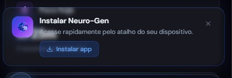

# PWA — Implementação no Neuro-Gen

**Projeto:** Neuro-Gen Web (`web/`)  
**Stack:** Vite 5 + React 18 + TypeScript + `vite-plugin-pwa@2.0.0`  
**Data:** 2026-11-24

---

## Sumário

1. [O que é PWA e por que usamos](#1-o-que-é-pwa-e-por-que-usamos)
2. [Pré-requisitos e instalação](#2-pré-requisitos-e-instalação)
3. [Configuração do vite-plugin-pwa](#3-configuração-do-vite-plugin-pwa)
4. [Web App Manifest](#4-web-app-manifest)
5. [Service Worker e estratégias de cache](#5-service-worker-e-estratégias-de-cache)
6. [Hook `usePWA`](#6-hook-usepwa)
7. [Componente `InstallPrompt`](#7-componente-installprompt)
8. [Integração no `AppShell`](#8-integração-no-appshell)
9. [BottomNav — navegação mobile PWA](#9-bottomnav--navegação-mobile-pwa)
10. [Ícones e assets PWA](#10-ícones-e-assets-pwa)
11. [Coexistência com MSW (mock)](#11-coexistência-com-msw-mock)
12. [Comportamento standalone vs browser](#12-comportamento-standalone-vs-browser)
13. [Como instalar no dispositivo](#13-como-instalar-no-dispositivo)
14. [Troubleshooting](#14-troubleshooting)

---

## 1. O que é PWA e por que usamos

Uma **Progressive Web App (PWA)** é uma aplicação web que, quando instalada, se comporta como um app nativo: aparece na tela inicial do dispositivo, abre sem barra de endereço, funciona offline (via cache) e pode receber notificações push.

No Neuro-Gen isso é central porque o público-alvo (usuários neurodivergentes) se beneficia de acesso rápido e direto à agenda sem a fricção de abrir um browser. A mensagem de instalação que aparece no app é exatamente esse convite:



---

## 2. Pré-requisitos e instalação

### Contexto: projeto já existente

O Neuro-Gen não foi criado com o template PWA do Vite — o PWA foi adicionado a um projeto React+TypeScript já existente. Os passos abaixo refletem exatamente o que foi feito.

> **Nota:** se você estiver criando um projeto do zero com suporte PWA desde o início, pode usar:
> ```bash
> npm create vite@latest meu-pwa -- --template react
> cd meu-pwa
> npm install
> npm install -D vite-plugin-pwa
> ```
> O resultado é o mesmo — a diferença é que no projeto do zero o `vite.config.ts` começa limpo.

### Instalação no projeto existente

```bash
cd web
npm install -D vite-plugin-pwa@2.0.0
```

A versão `2.0.0` foi escolhida porque alinha com Vite 5 e usa Workbox 7, que traz suporte nativo a módulos ES no Service Worker.

---

## 3. Configuração do vite-plugin-pwa

Arquivo: `web/vite.config.ts`

```ts
import { defineConfig } from 'vite'
import react from '@vitejs/plugin-react'
import path from 'path'
import { VitePWA } from 'vite-plugin-pwa'

export default defineConfig({
  plugins: [
    react(),
    VitePWA({
      registerType: 'autoUpdate',       // SW atualiza automaticamente sem prompt
      includeAssets: [                  // Assets pré-cacheados no install do SW
        'favicon.svg',
        'favicon.png',
        'apple-touch-icon.png',
        'logo-192.webp',
      ],
      manifest: { /* ver seção 4 */ },
      workbox: { /* ver seção 5 */ },
      devOptions: {
        enabled: false,                 // SW desativado em dev (conflito com MSW)
      },
    }),
  ],
  resolve: {
    alias: { '@': path.resolve(__dirname, './src') },
  },
  server: {
    port: 3000,
    proxy: {
      '/api': {
        target: process.env.VITE_API_URL || 'http://localhost:8080',
        changeOrigin: true,
      },
    },
  },
})
```

### Por que `registerType: 'autoUpdate'`?

| Opção | Comportamento |
|-------|---------------|
| `autoUpdate` | SW atualiza silenciosamente em background, sem perguntar ao usuário. Próximo acesso já usa a versão nova. |
| `prompt` | Exibe um prompt manual pedindo ao usuário para recarregar. Mais controle, mais complexidade. |

Escolhemos `autoUpdate` porque o app é uma agenda — o usuário não precisa gerenciar versões. Atualizações silenciosas reduzem carga cognitiva para o público neurodivergente.

---

## 4. Web App Manifest

O `manifest` dentro do `VitePWA({})` gera automaticamente o arquivo `manifest.webmanifest` no build. Não é necessário criar um `manifest.json` manual.

```ts
manifest: {
  name: 'Neuro-Gen',
  short_name: 'Neuro-Gen',
  description: 'Agenda adaptativa para neurodivergentes — foco, emoção e organização.',
  theme_color: '#06080f',         // Cor da barra de status no Android
  background_color: '#06080f',   // Cor da splash screen
  display: 'standalone',         // Remove barra de endereço do browser
  orientation: 'portrait',       // Travado em retrato
  scope: '/',
  start_url: '/dashboard',       // Abre direto no Dashboard ao instalar
  lang: 'pt-BR',
  categories: ['productivity', 'health', 'lifestyle'],
  icons: [
    { src: '/logo-64.webp',          sizes: '64x64',   type: 'image/webp' },
    { src: '/logo-192.webp',         sizes: '192x192', type: 'image/webp' },
    { src: '/apple-touch-icon.png',  sizes: '180x180', type: 'image/png',  purpose: 'apple touch icon' },
    { src: '/favicon.png',           sizes: '32x32',   type: 'image/png',  purpose: 'any maskable' },
  ],
  shortcuts: [
    { name: 'Agenda', short_name: 'Agenda', url: '/agenda', icons: [...] },
    { name: 'Foco',   short_name: 'Foco',   url: '/focus',  icons: [...] },
  ],
},
```

### Campos importantes

| Campo | Função |
|-------|--------|
| `display: 'standalone'` | O app abre sem UI do browser (sem barra de endereço). É este campo que transforma a web app em "app nativo". |
| `start_url: '/dashboard'` | Ao abrir o ícone da tela inicial, o usuário cai direto no Dashboard. |
| `theme_color` | Cor da barra de status do Android. Deve combinar com o design. |
| `shortcuts` | Atalhos de longa pressão no ícone (Android). Aparece um mini-menu com "Agenda" e "Foco". |
| `icons` com `purpose: 'any maskable'` | Necessário para ícones adaptativos no Android (evita bordas brancas no ícone). |

### Como verificar o manifest gerado

Após `npm run build`, o arquivo `dist/manifest.webmanifest` contém o JSON completo. No browser, em DevTools → Application → Manifest você vê tudo parseado.

---

## 5. Service Worker e estratégias de cache

O `vite-plugin-pwa` usa **Workbox** internamente para gerar o Service Worker. Configuramos o bloco `workbox` para controlar como cada tipo de recurso é cacheado:

```ts
workbox: {
  runtimeCaching: [
    // API — network-first: tenta a rede, cai no cache se offline
    {
      urlPattern: /^\/api\//,
      handler: 'NetworkFirst',
      options: {
        cacheName: 'api-cache',
        expiration: {
          maxEntries: 50,          // Máximo de 50 rotas cacheadas
          maxAgeSeconds: 300,      // Cache válido por 5 minutos
        },
        networkTimeoutSeconds: 10,
      },
    },
    // Google Fonts CSS — stale-while-revalidate: serve do cache e atualiza em background
    {
      urlPattern: /https:\/\/fonts\.googleapis\.com/,
      handler: 'StaleWhileRevalidate',
      options: { cacheName: 'google-fonts-stylesheets' },
    },
    // Google Fonts arquivos — cache-first: fontes raramente mudam
    {
      urlPattern: /https:\/\/fonts\.gstatic\.com/,
      handler: 'CacheFirst',
      options: {
        cacheName: 'google-fonts-webfonts',
        expiration: {
          maxEntries: 20,
          maxAgeSeconds: 60 * 60 * 24 * 365, // 1 ano
        },
      },
    },
  ],
  navigateFallback: null, // Desabilitado para não conflitar com MSW
},
```

### Estratégias de cache

| Estratégia | Comportamento | Usado para |
|------------|---------------|-----------|
| `NetworkFirst` | Tenta a rede; se falhar (offline), serve do cache | API `/api/*` |
| `CacheFirst` | Serve do cache; se não tiver, vai à rede | Fontes (imutáveis) |
| `StaleWhileRevalidate` | Serve do cache imediatamente, atualiza em background | CSS de fontes |

### Por que `navigateFallback: null`?

O `navigateFallback` faz o SW interceptar navegações e servir o `index.html` do cache — útil para SPAs. Desativamos porque em desenvolvimento o **MSW (Mock Service Worker)** também registra um SW para interceptar chamadas de API, e os dois conflitam. Com `null`, o Vite router cuida do fallback via configuração do Nginx (produção) ou proxy do Vite dev server.

---

## 6. Hook `usePWA`

Arquivo: `web/src/shared/hooks/usePWA.ts`

Este hook encapsula toda a lógica nativa do browser para detectar se o app pode ser instalado e disparar o prompt de instalação.

```ts
import { useState, useEffect } from 'react'

// Tipo para o evento nativo do browser — não está nos tipos padrão do TS
interface BeforeInstallPromptEvent extends Event {
  prompt(): Promise<void>
  userChoice: Promise<{ outcome: 'accepted' | 'dismissed' }>
}

export function usePWA() {
  const [deferredPrompt, setDeferredPrompt] = useState<BeforeInstallPromptEvent | null>(null)
  const [isInstallable, setIsInstallable]   = useState(false)
  const [isInstalled, setIsInstalled]       = useState(false)
  const [isStandalone, setIsStandalone]     = useState(false)

  useEffect(() => {
    // Detecta se já está rodando como PWA instalada
    const standalone =
      window.matchMedia('(display-mode: standalone)').matches ||
      (navigator as any).standalone === true  // iOS Safari

    setIsStandalone(standalone)
    setIsInstalled(standalone)

    // Captura o evento do browser ANTES de ele exibir o prompt nativo
    // e.preventDefault() cancela o prompt automático — controlamos manualmente
    const handler = (e: Event) => {
      e.preventDefault()
      setDeferredPrompt(e as BeforeInstallPromptEvent)
      setIsInstallable(true)
    }

    window.addEventListener('beforeinstallprompt', handler)

    // Evento disparado pelo browser após instalação confirmada
    window.addEventListener('appinstalled', () => {
      setIsInstalled(true)
      setIsInstallable(false)
      setDeferredPrompt(null)
    })

    return () => window.removeEventListener('beforeinstallprompt', handler)
  }, [])

  // Função chamada pelo botão "Instalar app"
  async function promptInstall() {
    if (!deferredPrompt) return false
    await deferredPrompt.prompt()          // Exibe o prompt nativo do browser
    const { outcome } = await deferredPrompt.userChoice  // Aguarda decisão do usuário
    setDeferredPrompt(null)
    setIsInstallable(false)
    return outcome === 'accepted'
  }

  return { isInstallable, isInstalled, isStandalone, promptInstall }
}
```

### Fluxo do `beforeinstallprompt`

```
Browser verifica critérios PWA
  │
  ▼
Dispara 'beforeinstallprompt'
  │
  ├─ Sem nosso handler → browser mostra prompt automático (não queremos)
  │
  └─ Com nosso handler:
       e.preventDefault()         ← cancela prompt automático
       setDeferredPrompt(e)       ← guarda o evento para usar depois
       setIsInstallable(true)     ← <InstallPrompt> aparece na tela
         │
         ▼
       Usuário clica "Instalar app"
         │
         ▼
       deferredPrompt.prompt()    ← exibe prompt nativo manualmente
         │
         ▼
       deferredPrompt.userChoice  ← 'accepted' ou 'dismissed'
```

### Estados retornados

| Estado | Descrição |
|--------|-----------|
| `isInstallable` | `true` quando o browser emitiu `beforeinstallprompt` — significa que os critérios PWA foram cumpridos e o app pode ser instalado |
| `isInstalled` | `true` se já está rodando como PWA ou após instalação confirmada |
| `isStandalone` | `true` se abrindo em modo standalone (sem chrome do browser) |
| `promptInstall` | Função que dispara o prompt nativo; retorna `true` se o usuário aceitou |

### Critérios do browser para emitir `beforeinstallprompt`

O browser só emite esse evento se **todos** os critérios forem cumpridos:

- ✅ App servido via HTTPS (ou `localhost`)
- ✅ Tem um `manifest.webmanifest` válido com `name`, `icons`, `start_url`, `display`
- ✅ Tem um Service Worker registrado com um fetch handler
- ✅ Ícone com pelo menos 192×192px
- ✅ Usuário interagiu com a página (engajamento mínimo)

---

## 7. Componente `InstallPrompt`

Arquivo: `web/src/shared/components/pwa/InstallPrompt.tsx`

Este componente renderiza o banner de instalação visível na imagem de referência (`pwa_install_mensagem.png`). Ele só aparece quando `isInstallable === true` e não foi dispensado.

```tsx
import { useState } from 'react'
import { Download, X } from 'lucide-react'
import { usePWA } from '@/shared/hooks/usePWA'
import { cn } from '@/shared/lib/cn'

export function InstallPrompt() {
  const { isInstallable, promptInstall } = usePWA()
  const [dismissed, setDismissed]       = useState(false)

  // Nada a renderizar se não é instalável ou foi dispensado
  if (!isInstallable || dismissed) return null

  return (
    <div
      className={cn(
        // Mobile: ancorado acima do BottomNav (bottom-[100px])
        // Desktop: canto inferior direito (lg:right-6 lg:bottom-6 lg:w-80)
        'fixed bottom-[100px] left-3 right-3 z-50 lg:left-auto lg:right-6 lg:bottom-6 lg:w-80',
        'glass-card p-4 animate-slide-up',
        'border border-brand/30',
      )}
      role="banner"
      aria-live="polite"   // Anuncia o banner para leitores de tela
    >
      <div className="flex items-start gap-3">
        {/* Ícone do app */}
        <div className="flex-shrink-0 w-10 h-10 rounded-xl bg-brand-gradient
                        flex items-center justify-center shadow-glow-brand">
          
        </div>

        {/* Texto e botão de instalação */}
        <div className="flex-1 min-w-0">
          <p className="text-sm font-semibold text-slate-100 leading-tight">
            Instalar Neuro-Gen
          </p>
          <p className="text-xs text-slate-400 mt-0.5 leading-relaxed">
            Acesse rapidamente pelo atalho do seu dispositivo.
          </p>
          <button
            onClick={() => promptInstall()}
            className={cn(
              'mt-2 inline-flex items-center gap-1.5 text-xs font-medium',
              'px-3 py-1.5 rounded-lg',
              'bg-brand/20 text-brand-light border border-brand/30',
              'hover:bg-brand/30 transition-colors',
              'focus-visible:outline-none focus-visible:ring-2 focus-visible:ring-brand/60',
            )}
          >
            <Download size={12} aria-hidden />
            Instalar app
          </button>
        </div>

        {/* Botão fechar — dispensa o banner sem instalar */}
        <button
          onClick={() => setDismissed(true)}
          aria-label="Fechar sugestão de instalação"
          className={cn(
            'flex-shrink-0 w-7 h-7 flex items-center justify-center rounded-full',
            'text-slate-500 hover:text-slate-200 hover:bg-glass transition-colors',
            'focus-visible:outline-none focus-visible:ring-2 focus-visible:ring-brand/60',
          )}
        >
          <X size={14} aria-hidden />
        </button>
      </div>
    </div>
  )
}
```

### Posicionamento responsivo

```
Mobile (< lg)                Desktop (≥ lg)
┌──────────────────────┐     ┌──────────────────────────────────────┐
│                      │     │                                      │
│  conteúdo do app     │     │  conteúdo do app                     │
│                      │     │                                      │
│ ┌──────────────────┐ │     │                     ┌──────────────┐ │
│ │  InstallPrompt   │ │     │                     │InstallPrompt │ │
│ └──────────────────┘ │     │                     └──────────────┘ │
│ ┌──────────────────┐ │     └──────────────────────────────────────┘
│ │   BottomNav      │ │
│ └──────────────────┘ │
└──────────────────────┘
```

No mobile, o banner fica 100px acima do fundo (`bottom-[100px]`) para não cobrir o `BottomNav`. No desktop fica fixo no canto inferior direito com largura de 320px.

### Decisão de UX: sem persistência no `localStorage`

O estado `dismissed` é local ao componente — ao recarregar a página, o banner pode aparecer novamente se o critério `isInstallable` continuar verdadeiro. Isso é intencional: não queremos bloquear permanentemente a sugestão por um clique acidental. O browser tem sua própria lógica para limitar quantas vezes exibe o prompt nativo.

---

## 8. Integração no `AppShell`

Arquivo: `web/src/shared/components/layout/AppShell.tsx`

O `AppShell` é o layout base de todas as páginas autenticadas. É onde o `InstallPrompt` e o `BottomNav` são montados.

```tsx
export function AppShell({ topBarTitle, topBarActions }: AppShellProps) {
  const isPwa = useIsPwa()   // Detecta display-mode: standalone

  return (
    <div className="flex h-dvh overflow-hidden bg-base-950 relative">

      {/* Sidebar desktop — oculta quando rodando como PWA standalone */}
      {!isPwa && (
        <div className="hidden lg:flex relative flex-shrink-0 z-30">
          <Sidebar />
        </div>
      )}

      {/* TopBar — oculta como PWA (a BottomNav substitui a navegação) */}
      {!isPwa && <TopBar title={topBarTitle} actions={topBarActions} />}

      <main className="flex-1 overflow-y-auto pb-[88px] lg:pb-0">
        <Outlet />
      </main>

      {/* Sempre visível — só o CSS lg:hidden controla em desktop */}
      <BottomNav />

      {/* Banner de instalação */}
      <InstallPrompt />

      <ToastContainer />
    </div>
  )
}
```

### `useIsPwa` — detectando modo standalone

```ts
function useIsPwa() {
  return typeof window !== 'undefined' &&
    window.matchMedia('(display-mode: standalone)').matches
}
```

Quando o app está instalado e abre como PWA:
- `display-mode: standalone` é `true`
- Sidebar e TopBar são ocultados (a BottomNav assume toda a navegação)
- O layout fica mais limpo, como um app nativo

### `pb-[88px] lg:pb-0`

O `main` tem padding inferior de 88px no mobile para o conteúdo não ficar atrás do `BottomNav` fixo. No desktop (`lg:`), remove esse padding porque o `BottomNav` está oculto (`lg:hidden`).

---

## 9. BottomNav — navegação mobile PWA

Arquivo: `web/src/shared/components/layout/BottomNav.tsx`

A `BottomNav` é a espinha dorsal da navegação quando o app está instalado como PWA. Ela substitui a Sidebar do desktop.

```tsx
export function BottomNav() {
  const user     = useAuthStore((s) => s.user)
  const location = useLocation()

  // Filtra itens por role (Vault só aparece para TITULAR)
  const visible = NAV_ITEMS.filter(
    (item) => !item.roles || (user?.role && item.roles.includes(user.role)),
  )

  return (
    <nav
      className="lg:hidden fixed bottom-0 inset-x-0 z-40 pb-safe"
      aria-label="Navegação principal mobile"
    >
      <div className="relative mx-3 mb-3">
        <div className="flex items-end justify-around
                        bg-base-800/90 backdrop-blur-xl
                        border border-glass-border
                        rounded-[28px] px-2 pt-2 pb-2
                        shadow-[0_8px_40px_rgba(0,0,0,0.6)]">
          {visible.map((item) => {
            const isActive = location.pathname.startsWith(item.to)
            return (
              <NavLink key={item.to} to={item.to} aria-label={item.label}>
                {/* Ícone circular elevado quando ativo */}
                <span
                  className="w-11 h-11 rounded-full transition-all duration-300"
                  style={isActive ? {
                    // Eleva o botão ativo acima do BottomNav
                    transform: 'translateY(-12px)',
                    background: `linear-gradient(145deg, ${item.color}22, ${item.color}44)`,
                    border: `1.5px solid ${item.color}55`,
                  } : undefined}
                >
                  <Icon size={isActive ? 22 : 20} style={{ color: isActive ? item.color : 'rgba(148,163,184,0.7)' }} />

                  {/* Ponto indicador abaixo do ícone ativo */}
                  {isActive && (
                    <span className="absolute -bottom-1.5 w-1 h-1 rounded-full"
                          style={{ background: item.color }} />
                  )}
                </span>

                {/* Label visível só no item ativo */}
                <span className={cn('text-[9px] font-medium', isActive ? 'opacity-100' : 'opacity-0')}>
                  {item.label}
                </span>
              </NavLink>
            )
          })}
        </div>
      </div>
    </nav>
  )
}
```

### Design do BottomNav

O efeito visual principal é o **botão circular elevado** (`-translate-y-3`) no item ativo:

```
  ╭────╮
  │ ⏱  │  ← ícone ativo elevado acima do nav, com halo colorido
  │ Foco│
╭─╰────╯──────────────────────────────────────────╮
│  🗓  •  💚  •  🏠  •  🔐  •  🔗  •  🔔  •  ⚙  │  ← barra glass
╰─────────────────────────────────────────────────╯
```

Itens de navegação definidos:

| Rota | Label | Cor | Visível para |
|------|-------|-----|--------------|
| `/dashboard` | Início | `#60a5fa` | Todos |
| `/agenda` | Agenda | `#a5b4fc` | Todos |
| `/focus` | Foco | `#c084fc` | Todos |
| `/emotional` | Emocional | `#22d3ee` | Todos |
| `/vault` | Cofre | `#fbbf24` | Apenas TITULAR |
| `/links` | Vínculos | `#d8b4fe` | Todos |
| `/notifications` | Avisos | `#60a5fa` | Todos |
| `/settings` | Config | `#94a3b8` | Todos |

### `pb-safe` — suporte ao notch do iPhone

```css
/* globals.css */
.pb-safe {
  padding-bottom: env(safe-area-inset-bottom);
}
```

A propriedade CSS `env(safe-area-inset-bottom)` garante que o BottomNav não fique atrás da barra de gestos do iPhone (home indicator). Sem isso, o último botão ficaria parcialmente coberto no iPhone X e posteriores.

---

## 10. Ícones e assets PWA

Pasta: `web/public/`

| Arquivo | Tamanho | Uso |
|---------|---------|-----|
| `logo-64.webp` | 64×64 | Ícone pequeno no manifest e shortcuts |
| `logo-192.webp` | 192×192 | Ícone principal Android / manifest PWA |
| `apple-touch-icon.png` | 180×180 | Ícone na tela inicial do iOS (Safari) |
| `favicon.png` | 32×32 | Favicon + maskable para Android |
| `favicon.svg` | vetorial | Favicon SVG (browsers modernos) |
| `logo.webp` | full-res | Logo em tamanho completo |
| `mockServiceWorker.js` | — | Service Worker do MSW (desenvolvimento) |

### Ícone maskable vs any

O campo `purpose` nos ícones do manifest controla como o Android exibe o ícone:

- `purpose: 'any'` — ícone com fundo transparente, mostrado como está.
- `purpose: 'maskable'` — o Android aplica uma forma (círculo, squircle) ao ícone. Requer que o conteúdo principal fique na "safe zone" (centro 80% da imagem).

No Neuro-Gen, o `favicon.png` tem `purpose: 'any maskable'` — indica que pode ser usado em ambos os modos.

### Como o `vite-plugin-pwa` serve os ícones

O plugin referencia os ícones da pasta `public/` automaticamente no manifest gerado. Os arquivos em `public/` são copiados para a raiz do `dist/` no build, ficando acessíveis como `/logo-192.webp`, `/apple-touch-icon.png`, etc.

---

## 11. Coexistência com MSW (mock)

O Neuro-Gen usa **MSW (Mock Service Worker)** para interceptar chamadas à API em desenvolvimento sem precisar do backend real. Tanto o PWA quanto o MSW usam Service Workers — isso cria conflito.

### Solução adotada

```ts
// vite.config.ts
VitePWA({
  devOptions: {
    enabled: false,  // SW do PWA desativado completamente em dev
  },
  workbox: {
    navigateFallback: null,  // Sem interceptação de navegação
  },
})
```

| Ambiente | PWA Service Worker | MSW Service Worker |
|----------|-------------------|-------------------|
| `dev` (`npm run dev`) | ❌ Desativado | ✅ Ativo (intercepta `/api/*`) |
| `build + preview` (`npm run build && npm run preview`) | ✅ Ativo | ❌ Não carregado |
| Docker (produção) | ✅ Ativo | ❌ Não carregado |

A variável `VITE_MOCK=true` (que ativa o MSW) é usada apenas em dev. O Docker build define `VITE_MOCK=false` nos args, garantindo que o build de produção não carregue o MSW.

### `mockServiceWorker.js` em `public/`

O arquivo `web/public/mockServiceWorker.js` é gerado pelo comando:

```bash
npx msw init web/public --save
```

Ele precisa estar na raiz do `public/` (não em subpasta) para o escopo do SW ser `/`. Configurado no `package.json`:

```json
"msw": {
  "workerDirectory": ["public"]
}
```

---

## 12. Comportamento standalone vs browser

Quando o usuário instala o app e abre pelo ícone da tela inicial, o CSS media query `(display-mode: standalone)` retorna `true`. O `AppShell` usa isso para ajustar o layout:

```
Modo browser (tab comum)         Modo standalone (PWA instalada)
┌────────────────────────┐       ┌────────────────────────┐
│ ░░░░░ TopBar ░░░░░░░░░│       │                        │  ← sem TopBar
├──────┬─────────────────┤       ├────────────────────────┤
│      │                 │       │                        │
│Sidebar  Conteúdo       │       │    Conteúdo            │
│      │                 │       │                        │
│      │                 │       │                        │
└──────┴─────────────────┘       ├────────────────────────┤
                                 │ ░░░░░ BottomNav ░░░░░░│  ← nav principal
                                 └────────────────────────┘
```

A Sidebar (desktop) e TopBar são ocultadas no modo PWA — a BottomNav assume toda a navegação, criando uma experiência visual idêntica a um app nativo.

---

## 13. Como instalar no dispositivo

### Android (Chrome / Edge)

1. Acesse o app em `http://localhost:3000` (dev) ou pela URL de produção
2. O browser verifica os critérios PWA automaticamente
3. O banner `InstallPrompt` aparece na parte inferior da tela
4. Clique em **"Instalar app"** → aparece o prompt nativo do Chrome
5. Confirme → ícone criado na tela inicial

Alternativamente: menu do browser (⋮) → **"Adicionar à tela inicial"** / **"Instalar app"**

### iOS (Safari)

O iOS Safari não emite `beforeinstallprompt` — o banner `InstallPrompt` **não aparece** no iOS. A instalação é manual:

1. Abra o app no Safari
2. Toque no ícone de Compartilhar (□↑)
3. Role para baixo → **"Adicionar à Tela de Início"**
4. Confirme o nome → ícone criado

> **Por que não funciona no iOS?** A Apple implementou PWA de forma proprietária no Safari. O evento `beforeinstallprompt` não existe no WebKit. Para guiar usuários iOS, seria necessário detectar `navigator.standalone === undefined` (iOS não instalado) e exibir instruções manuais.

### Desktop (Chrome / Edge)

1. Acesse o app no browser
2. Aparece um ícone de instalação (⊕) na barra de endereço
3. Ou: menu (⋮) → **"Instalar Neuro-Gen"**

---

## 14. Troubleshooting

### Banner de instalação não aparece

**Causas possíveis:**

| Causa | Solução |
|-------|---------|
| App não servido via HTTPS | Em prod use HTTPS; em dev `localhost` é exceto |
| Manifest inválido | DevTools → Application → Manifest — verificar erros |
| Ícone faltando ou tamanho errado | Precisa de pelo menos um ícone 192×192 |
| App já instalado | `isInstallable` fica `false` após instalação |
| Browser já perguntou e usuário recusou | Chrome bloqueia por alguns dias após recusa |
| `devOptions.enabled: false` | Em dev o SW está desativado — instale via build preview |

### Service Worker antigo em produção

Se o app não atualiza após deploy:

1. DevTools → Application → Service Workers
2. Clique em **"Update"** ou **"Unregister"**
3. Hard refresh (Ctrl+Shift+R)

Com `registerType: 'autoUpdate'` isso raramente acontece — o SW se atualiza silenciosamente.

### Conflito MSW × PWA em dev

Se aparecer erro `Failed to register a ServiceWorker` em dev:

1. DevTools → Application → Service Workers → **"Unregister all"**
2. Hard refresh
3. Certifique-se que `devOptions.enabled: false` está no `vite.config.ts`

### `navigateFallback` e rotas 404

Se rotas diretas (ex: `localhost:3000/agenda`) retornam 404 em produção, o Nginx precisa do fallback SPA. No `nginx.conf` do projeto:

```nginx
location / {
    try_files $uri $uri/ /index.html;
}
```

Isso já está configurado em `web/nginx.conf` — o Docker usa essa config.

---

## Resumo da arquitetura PWA

```
vite.config.ts
└── VitePWA()
    ├── manifest → /dist/manifest.webmanifest
    │              (name, icons, start_url, display, shortcuts)
    ├── workbox  → /dist/sw.js (Service Worker gerado)
    │              NetworkFirst para /api/
    │              CacheFirst para fontes
    └── includeAssets → pré-cache de favicon, ícones

web/src/
├── shared/
│   ├── hooks/usePWA.ts           ← beforeinstallprompt, promptInstall()
│   └── components/
│       ├── pwa/InstallPrompt.tsx ← banner "Instalar Neuro-Gen"
│       └── layout/
│           ├── AppShell.tsx      ← monta InstallPrompt + BottomNav
│           │                        oculta Sidebar/TopBar em standalone
│           └── BottomNav.tsx     ← navegação circular mobile PWA

web/public/
├── logo-192.webp         ← ícone principal Android
├── apple-touch-icon.png  ← ícone iOS
├── logo-64.webp          ← favicon / shortcuts
└── mockServiceWorker.js  ← SW do MSW (apenas dev)
```
